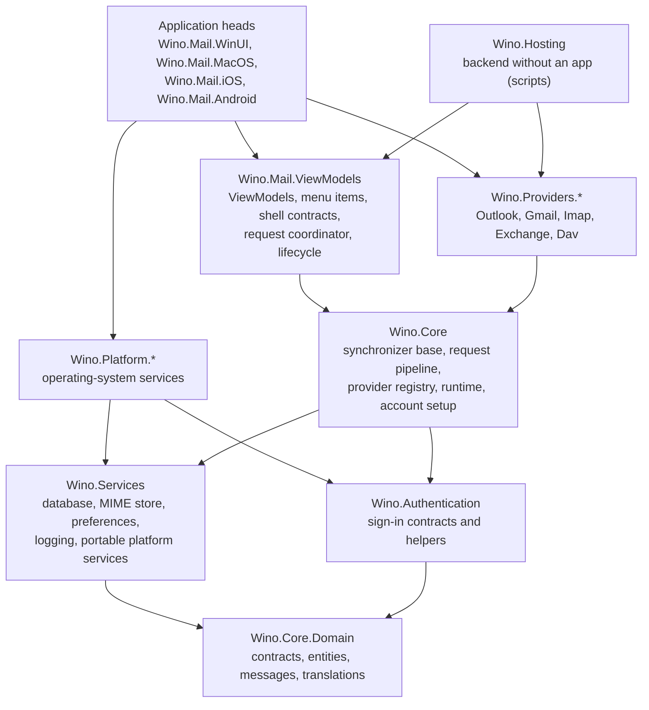
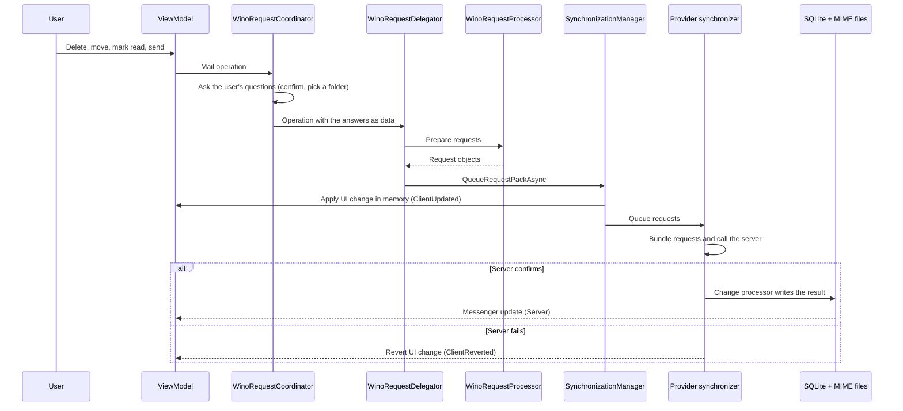

# Contributing to Wino Mail

Wino Mail started as a personal project and grew through community interest. Contributions can include code, documentation, bug reports, and proposals.

Read this guide before you start implementation. For coding-agent rules, also read [`AGENTS.md`](AGENTS.md) and any closer `AGENTS.md` file.

## Contribution policy

Create an issue before you work on a new bug or feature. If an issue already exists, comment there before you start implementation.

Create a proposal before you design a large feature or a new subsystem. Wait for maintainer approval before you start that work.

Wino preserves the direct experience of Windows Mail and Calendar. A proposal can be rejected when it conflicts with this product direction.

AI-assisted contributions are welcome. Contributors remain responsible for the design, code, security, and accuracy of every submitted change.

AI-assisted changes must obey the same architecture, coding rules, and maintainer decisions as manually written changes.

## Development requirements

Wino has four applications: a packaged WinUI 3 app for Windows, a native AppKit app for macOS, a UIKit app for iPhone and iPad, and an Android app. They share the .NET 10 backend and use the .NET SDK from [`global.json`](global.json).

For Windows, install WinApp CLI 0.7 or later and enable Windows Developer Mode.
For VS Code debugging, install Microsoft's C# extension.
Visual Studio with the .NET desktop workload is also supported.
Release Native AOT builds need the C++ build tools described in the [Windows release guide](docs/releases-windows.md).

For macOS, install the `macos` workload and its matching Xcode. See the [macOS development guide](docs/harness/development-macos.md). The [iOS](docs/harness/development-ios.md) and [Android](docs/harness/development-android.md) guides list their workloads and tools.

## Build and run

On Windows, open the repository folder in VS Code. Select **Debug Wino Mail (packaged, x64)** and press **F5**.
The task runs `winapp run` against the app project. WinApp builds and deploys the package, then VS Code attaches the C# debugger.

For terminal use:

```powershell
dotnet build src/Wino.Mail.WinUI/Wino.Mail.WinUI.csproj -c Debug -p:Platform=x64 -p:RuntimeIdentifier=win-x64
winapp run src/Wino.Mail.WinUI/Wino.Mail.WinUI.csproj --arch x64 --detach
```

The SDK handles restore and compilation. F5 uses one PowerShell helper to skip compilation when inputs and output are unchanged.
The Windows app is [`src/Wino.Mail.WinUI`](src/Wino.Mail.WinUI/Wino.Mail.WinUI.csproj).
See the [Windows development guide](docs/harness/development-windows.md) for debugger behavior and package troubleshooting.
On a Mac, open [`WinoMail.MacOS.code-workspace`](WinoMail.MacOS.code-workspace) and follow the [macOS development guide](docs/harness/development-macos.md).

## Testing and maintenance

Manual application testing uses the remote [mail lab](tools/lab/README.md). Its servers are reachable from any device; fetching the account manifest needs SSH access to the lab host.
The repository has no automated test projects. Verify backend changes by running the real code from a single-file script through [`Wino.Hosting`](src/Wino.Hosting/AGENTS.md), and UI changes with manual checks in the running application.
Agent-driven UI suites and automation scripts are retired.

Use the [script index](scripts/README.md) for release packaging, lab provisioning, XAML maintenance, and localization.
Follow the verification scope in [`AGENTS.md`](AGENTS.md).

## Project architecture

Wino contains four application modes: Mail, Calendar, People, and To Do. Each application shares one database, service layer, ViewModel layer, and account model across the modes. On Windows the modes share one WinUI executable.

Mail synchronization supports Microsoft Graph, the Gmail API, IMAP/SMTP, POP3/SMTP, and on-premises Exchange over EWS or MAPI over HTTP. Calendar, contacts, and tasks can use the provider, CalDAV and CardDAV, or local storage.

The project uses [MimeKit](https://github.com/jstedfast/MimeKit) and [MailKit](https://github.com/jstedfast/MailKit/) for MIME and standard mail protocols. Outlook uses the official [Microsoft.Graph](https://github.com/microsoftgraph/msgraph-sdk-dotnet) package. Gmail and the other Google APIs use hand-written REST clients, because Google's library does not survive trimming and Native AOT.

### Layers



The dependency rules:

- `Wino.Core.Domain` has no MVVM or MIME dependency and holds no UI state. Contracts and models that need MimeKit or MailKit live in `Wino.Services` or `Wino.Core`, in the namespace of their folder.
- `Wino.Core` and the shared projects below it reference no provider project. Shared code asks `IMailProviderRegistry` for a provider's module and its `MailProviderTraits`; it never switches on the provider type.
- A provider project references `Wino.Core` only, and never another provider project. Only the application heads and `Wino.Hosting` reference the providers.
- No dialog, navigation, theme, or dispatcher contract is used below `Wino.Mail.ViewModels`. The `WINOUI001` analyzer fails the build otherwise. The backend takes answers as data on the request or returns a typed result to the ViewModel.
- The portable projects target plain `net10.0` and carry no CsWinRT reference. The Windows heads list the shared types WinUI receives in their `WinRTExposedTypes.cs` files.

### Request flow

Every user action that changes server data goes through one pipeline. The database changes only after the server confirms; the UI change is applied in memory first and reverted on failure. [`src/Wino.Core/AGENTS.md`](src/Wino.Core/AGENTS.md) describes each step.



## Project guide

Shared backend:

- [`Wino.Core.Domain`](src/Wino.Core.Domain) contains service contracts, entities, enums, models, the messenger message records (`Messaging/`, namespaces `Wino.Core.Domain.Messaging.*`), and the translations.
- [`Wino.Services`](src/Wino.Services) contains the SQLite database and schema, the MIME file store, account, mail, folder, calendar, contact, and task services, preferences, logging, the Wino account client, and the portable platform services shared by the macOS, iOS, Android, and hosting heads (`AddPortablePlatformServices`).
- [`Wino.Core`](src/Wino.Core) contains the synchronizer base classes, the request pipeline, the provider registry, `SynchronizationManager`, `ApplicationRuntime`, account setup, and autodiscovery.
- [`Wino.Providers.Outlook`](src/Wino.Providers.Outlook), [`Wino.Providers.Gmail`](src/Wino.Providers.Gmail), [`Wino.Providers.Imap`](src/Wino.Providers.Imap) (IMAP, POP3, and SMTP), [`Wino.Providers.Exchange`](src/Wino.Providers.Exchange) (EWS and the MAPI protocol layer), and [`Wino.Providers.Dav`](src/Wino.Providers.Dav) (CalDAV and CardDAV) each hold one provider's synchronizer, change processor, error handlers, and services.
- [`Wino.Authentication`](src/Wino.Authentication) contains the sign-in contracts that hosts implement (`IOutlookAuthenticationHost`, `IGoogleAuthorizationCodeReceiver`, `IGoogleTokenStore`) and the shared Google and MSAL sign-in helpers. IMAP and POP3 credentials use [`CustomServerInformation`](src/Wino.Core.Domain/Entities/Shared/CustomServerInformation.cs).
- [`Wino.Mail.ViewModels`](src/Wino.Mail.ViewModels) is the one ViewModel library for all four applications. It also holds the pane menu items (`MenuItemCollection`, `MailFolderMenuBuilder`), the shell contracts (`ShellMenu`, `IShellMenuProvider`), `WinoRequestCoordinator`, `ApplicationLifecycleCoordinator`, and `NotificationResponseService`.
- [`Wino.Core.ML`](src/Wino.Core.ML) runs the on-device ONNX content-type model. [`Wino.Agent.Runtime`](src/Wino.Agent.Runtime) is the Wino Assistant runtime. [`Wino.PushRelay.Socket`](src/Wino.PushRelay.Socket) is the push relay socket client.
- [`Wino.SourceGenerators`](src/Wino.SourceGenerators) generates `Translator` and other compile-time code, and contains the repository analyzers.
- [`Wino.Hosting`](src/Wino.Hosting) runs the backend, up to the ViewModels, without an application. A single-file script references it with `#:project`. No application ships it.

Platforms and applications:

- [`Wino.Platform.Windows`](src/Wino.Platform.Windows) contains the Windows services (`AddWindowsPlatformServices`): notifications, sign-in hosts, token and secret storage, Store, widgets and tiles. [`Wino.Platform.Apple`](src/Wino.Platform.Apple), [`Wino.Platform.MacOS`](src/Wino.Platform.MacOS), [`Wino.Platform.iOS`](src/Wino.Platform.iOS), and [`Wino.Platform.Android`](src/Wino.Platform.Android) do the same for the other applications.
- [`Wino.Mail.WinUI`](src/Wino.Mail.WinUI) contains the Windows shell, pages, dialogs, styles, activation routes, and package manifest. [`Wino.NotificationHost`](src/Wino.NotificationHost) and [`Wino.WidgetHost`](src/Wino.WidgetHost) are its small companion executables.
- [`Wino.Mail.MacOS`](src/Wino.Mail.MacOS), [`Wino.Mail.iOS`](src/Wino.Mail.iOS) with [`Wino.Mail.UIKit`](src/Wino.Mail.UIKit) and [`Wino.Mail.UIKit.Phone`](src/Wino.Mail.UIKit.Phone), and [`Wino.Mail.Android`](src/Wino.Mail.Android) are the other application heads.
- [`controls`](controls) contains highly customized controls shared by Wino applications. It is not a general-purpose control library. [`controls/AGENTS.md`](controls/AGENTS.md) lists its projects.
- [`Wino.Editor.Core`](controls/Wino.Editor.Core) contains the HTML, CSS, and JavaScript assets for mail reading and composition. `Wino.Editor.WinUI`, `Wino.Editor.WebKit`, and `Wino.Editor.Android` host them.
- [`Wino.Mail.Controls.Playground.WinUI`](controls/Wino.Mail.Controls.Playground.WinUI) is the quick test application for controls before full application integration.

`WinoMail.slnx` holds the Windows solution. The other applications have `WinoMail.MacOS.slnx`, `WinoMail.iOS.slnx`, and `WinoMail.Android.slnx`.

## Notification architecture

The package manifest defines four visible application entries: Wino Mail, Wino Calendar, Wino People, and Wino To Do. They share the main WinUI executable.

Windows identifies packaged applications with an Application User Model ID (AUMID). Each application mode uses the AUMID of its own visible entry for notifications, so a toast shows that mode's name and icon in Notification Center.

Do not add hidden application entries (`AppListEntry="none"`). Microsoft Store rejects these headless entries unless the app has the `HeadlessAppBypass` waiver.

Each visible entry declares its own toast COM activator class, served by one small executable, [`Wino.NotificationHost`](src/Wino.NotificationHost), which contains the activation bridge. Windows starts the host under the identity of the toast's entry, so the host's AUMID identifies the application mode. This design keeps the toast COM activators out of the shared UI executable.

[`NotificationHostClient`](src/Wino.Platform.Windows/Services/NotificationHostClient.cs) shows and removes toasts inside the main process. It addresses the required AUMID with `ToastNotificationManager.CreateToastNotifier(aumid)`, which Windows allows for applications in the same package. No host process starts to show or remove a notification.

Notification clicks enter the matching COM activator. Windows starts the host, which writes an activation envelope, forwards it to the main application, and exits.

[`ForwardedNotificationActivationStore`](src/Wino.Mail.WinUI/Activation/ForwardedNotificationActivationStore.cs) reads the forwarded activation. [`AppNotificationHandler`](src/Wino.Mail.WinUI/Activation/AppNotificationHandler.cs) routes it to the correct application mode.

The activation envelope format and AUMID mappings live in [`Wino.NotificationHost.Contracts`](src/Wino.NotificationHost.Contracts).

Do not register all four notification identities in the main executable. Keep the COM activation path attached to the host executable.

## Data and application state

[`WinoApplication`](src/Wino.Mail.WinUI/WinoApplication.cs) initializes application data paths and starts the shared startup order through `ApplicationLifecycleCoordinator`. The SQLite database is `Wino210.db` in the application data folder; [`DatabaseService`](src/Wino.Services/DatabaseService.cs) creates and upgrades its schema.

The database stores mail and calendar metadata. [`MimeFileService`](src/Wino.Services/MimeFileService.cs) resolves downloaded MIME files from application-local storage.

[`PreferencesService`](src/Wino.Services/PreferencesService.cs) stores user settings and imported or exported preferences. [`StatePersistenceService`](src/Wino.Mail.WinUI/Services/StatePersistenceService.cs) stores temporary UI state.

On Windows, mail rendering and composition use [WebView2](https://learn.microsoft.com/en-us/microsoft-edge/webview2/) through `Wino.Editor.WinUI`, over the single asset bundle in [`Wino.Editor.Core`](controls/Wino.Editor.Core). Do not add a second editor asset bundle to an application project.

## View models and messaging

Wino uses [CommunityToolkit.Mvvm](https://learn.microsoft.com/en-us/dotnet/communitytoolkit/mvvm/) for observable properties, commands, and messaging. Observable types live in `Wino.Mail.ViewModels` and the heads; `Wino.Core.Domain` has no MVVM dependency.

Use public partial properties with `[ObservableProperty]`. Do not annotate private backing fields.

Register messenger recipients in `RegisterRecipients()`. Unregister them in `UnregisterRecipients()`.

Messenger handlers can run outside the UI thread. Dispatch UI-bound state and platform UI work through `ExecuteUIThread(...)` or the correct dispatcher. Take `IMessenger` through the constructor; the `WINOMSG001` analyzer fails the build on `WeakReferenceMessenger.Default` in shared code.

Each head has one composition root: [`App.xaml.cs`](src/Wino.Mail.WinUI/App.xaml.cs) on Windows, [`Composition.cs`](src/Wino.Mail.MacOS/Composition.cs) on macOS, [`Composition.cs`](src/Wino.Mail.iOS/Composition.cs) on iOS, [`AndroidComposition.cs`](src/Wino.Mail.Android/AndroidComposition.cs) on Android, and [`WinoHost`](src/Wino.Hosting/WinoHost.cs) in `Wino.Hosting`. Each one calls the same shared registrations:

- `RegisterSharedServices()` ([`ServicesContainerSetup`](src/Wino.Services/ServicesContainerSetup.cs)) and `RegisterCoreServices()` ([`CoreContainerSetup`](src/Wino.Core/CoreContainerSetup.cs)).
- `AddGmailProvider()`, `AddOutlookProvider()`, `AddImapProvider()`, `AddExchangeProvider()`, and `AddDavProvider()`, one per provider project, Gmail first.
- `RegisterWinoViewModels()` ([`WinoViewModelRegistration`](src/Wino.Mail.ViewModels/WinoViewModelRegistration.cs)), the single list of shared ViewModels.
- The platform services: `AddWindowsPlatformServices` on Windows, and `AddPortablePlatformServices` plus the platform's own services elsewhere.

Avoid new packages when the platform or repository already supplies the required function.

## Localization

For new development, add or update translations manually only in [`en_US/resources.json`](src/Wino.Core.Domain/Translations/en_US/resources.json), the English (en-US) source file.

Use the generated `Translator` properties in C# and XAML. Do not edit non-English resource files.

The maintainer generates translations for other languages from the English source before each public release.

## Controls and XAML

The `controls` projects contain highly customized controls for Wino. They are shared across Wino applications but are not general-purpose reusable libraries.

Use [`Wino.Mail.Controls.Playground.WinUI`](controls/Wino.Mail.Controls.Playground.WinUI) for quick control tests before integration into the full application.

Read [`controls/AGENTS.md`](controls/AGENTS.md) before you change a shared control. Format changed XAML with the repository harness before handoff.

Every icon comes from the WinoIcons fonts. To add one, follow [Add an icon](icons/README.md#add-an-icon). Do not copy an SVG into `icons/svg` by hand.

## Before you submit

1. Review the diff and remove unrelated changes.
2. Run the narrowest relevant build.
3. Run the XAML and UI checks when the change affects the interface.
4. Describe what you verified and what remains unverified.

## Additional help

The project has dedicated community channels:

- [UWP Community](https://discord.gg/wNMGxYZMFy), under **Apps & Projects → wino-mail**
- [Developer Sanctuary](https://discord.gg/windows-apps-hub-714581497222398064), under **Community Projects → wino-mail**

You can also contact `bkaankose (at) outlook.com`.

## Donate

You can [donate with PayPal](https://www.paypal.com/donate/?hosted_button_id=LGPERGGXFMQ7U).
