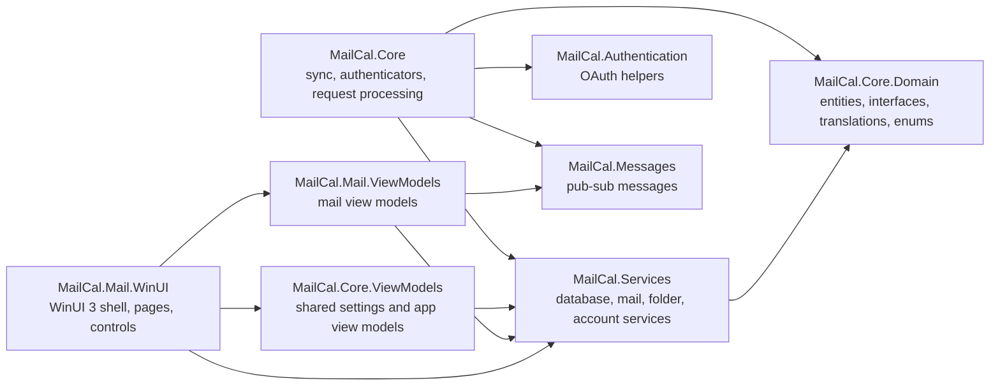
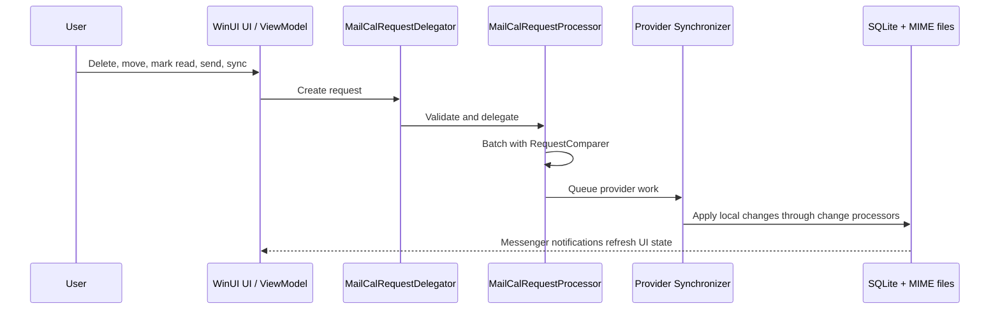

# Contributing to Mail-Cal

Mail-Cal is a standalone fork of [Wino Mail](https://github.com/bkaankose/Wino-Mail). Contributions can include code, documentation, bug reports, and proposals.

Read this guide before you start implementation. For coding-agent rules, also read [`AGENTS.md`](AGENTS.md) and any closer `AGENTS.md` file.

## Contribution policy

Create an issue before you work on a new bug or feature. If an issue already exists, comment there before you start implementation.

Create a proposal before you design a large feature or a new subsystem. Wait for maintainer approval before you start that work.

Mail-Cal preserves the direct experience of Windows Mail and Calendar. A proposal can be rejected when it conflicts with this product direction.

AI-assisted contributions are welcome. Contributors remain responsible for the design, code, security, and accuracy of every submitted change.

AI-assisted changes must obey the same architecture, coding rules, and maintainer decisions as manually written changes.

## Development requirements

Mail-Cal is a packaged WinUI 3 app for Windows. It uses the .NET SDK from [`global.json`](global.json).

For Windows, install WinApp CLI 0.7 or later and enable Windows Developer Mode.
For VS Code debugging, install Microsoft's C# extension.
Visual Studio with the .NET desktop workload is also supported.
Release Native AOT builds need the C++ build tools described in the [Windows release guide](docs/releases-windows.md).


## Build and run

On Windows, open the repository folder in VS Code. Select **Debug Mail-Cal (packaged, x64)** and press **F5**.
The task runs `winapp run` against the app project. WinApp builds and deploys the package, then VS Code attaches the C# debugger.

For terminal use:

```powershell
dotnet build src/MailCal.Mail.WinUI/MailCal.Mail.WinUI.csproj -c Debug -p:Platform=x64 -p:RuntimeIdentifier=win-x64
winapp run src/MailCal.Mail.WinUI/MailCal.Mail.WinUI.csproj --arch x64 --detach
```

The SDK handles restore and compilation. F5 uses one PowerShell helper to skip compilation when inputs and output are unchanged.
The active app is [`src/MailCal.Mail.WinUI`](src/MailCal.Mail.WinUI/MailCal.Mail.WinUI.csproj). Leave the deprecated UWP app unchanged.
See the [Windows development guide](docs/harness/development-windows.md) for debugger behavior and package troubleshooting.

## Testing and maintenance

Use the [local Docker lab](tools/local-lab/README.md) for manual application testing on Windows.
The repository has no automated test projects. Verify changes with builds and manual checks in the running application.
Agent-driven UI suites and automation scripts are retired.

Use the [script index](scripts/README.md) for release packaging, lab provisioning, XAML maintenance, and localization.
Follow the verification scope in [`AGENTS.md`](AGENTS.md).

## Project architecture

Mail-Cal contains four application modes: Mail, Calendar, People, and To Do. These modes share one WinUI executable, database, service layer, and account model.

Mail synchronization supports Microsoft Graph, Gmail API, IMAP/SMTP, and POP3/SMTP. Calendar, contacts, and tasks can use provider, DAV, or local backends.

The project uses [MimeKit](https://github.com/jstedfast/MimeKit) and [MailKit](https://github.com/jstedfast/MailKit/) for MIME and standard mail protocols. Microsoft Graph supplies Microsoft integrations. Google APIs supply Google integrations.

Provider authenticators live in [`MailCal.Authentication`](src/MailCal.Authentication). IMAP and POP3 credentials use [`CustomServerInformation`](src/MailCal.Core.Domain/Entities/Shared/CustomServerInformation.cs).

Mail actions pass through [`MailCalRequestDelegator`](src/MailCal.Core/Services/MailCalRequestDelegator.cs) and [`MailCalRequestProcessor`](src/MailCal.Core/Services/MailCalRequestProcessor.cs). These services prepare, batch, and send requests to the correct synchronizer.





## Project guide

- [`MailCal.Mail.WinUI`](src/MailCal.Mail.WinUI) contains the shell, pages, styles, activation routes, package manifest, and Windows services.
- [`MailCal.Mail.ViewModels`](src/MailCal.Mail.ViewModels) contains mail and application-mode view models.
- [`MailCal.Calendar.ViewModels`](src/MailCal.Calendar.ViewModels) contains calendar view models and calendar state.
- [`MailCal.Core.ViewModels`](src/MailCal.Core.ViewModels) contains shared settings and application view models.
- [`MailCal.Core`](src/MailCal.Core) contains synchronization, provider integrations, request processing, and change processors.
- [`MailCal.Services`](src/MailCal.Services) contains database, account, mail, folder, task, contact, preference, and file services.
- [`MailCal.Core.Domain`](src/MailCal.Core.Domain) contains shared contracts, entities, interfaces, translations, enums, and models.
- [`MailCal.Authentication`](src/MailCal.Authentication) contains Microsoft and Google OAuth helpers.
- [`MailCal.Messages`](src/MailCal.Messages) contains CommunityToolkit messenger contracts.
- [`MailCal.SourceGenerators`](src/MailCal.SourceGenerators) generates translation and other compile-time code.
- [`controls`](controls) contains highly customized controls shared by Mail-Cal applications. It is not a general-purpose control library.
- [`MailCal.Editor`](controls/MailCal.Editor) contains the HTML, CSS, and JavaScript assets for mail reading and composition.
- [`MailCal.Mail.Controls.Playground`](controls/MailCal.Mail.Controls.Playground) is the quick test application for controls before full application integration.

## Notification architecture

The package manifest defines four visible application entries: Mail-Cal, Mail-Cal Calendar, Mail-Cal People, and Mail-Cal To Do. They share the main WinUI executable.

Windows identifies packaged applications with an Application User Model ID (AUMID). Each application mode uses the AUMID of its own visible entry for notifications, so a toast shows that mode's name and icon in Notification Center.

Do not add hidden application entries (`AppListEntry="none"`). Microsoft Store rejects these headless entries unless the app has the `HeadlessAppBypass` waiver.

Each visible entry declares its own toast COM activator class, served by one small executable, [`MailCal.NotificationHost`](src/MailCal.NotificationHost), which contains the activation bridge. Windows starts the host under the identity of the toast's entry, so the host's AUMID identifies the application mode. This design keeps the toast COM activators out of the shared UI executable.

[`NotificationHostClient`](src/MailCal.Mail.WinUI/Services/NotificationHostClient.cs) shows and removes toasts inside the main process. It addresses the required AUMID with `ToastNotificationManager.CreateToastNotifier(aumid)`, which Windows allows for applications in the same package. No host process starts to show or remove a notification.

Notification clicks enter the matching COM activator. Windows starts the host, which writes an activation envelope, forwards it to the main application, and exits.

[`ForwardedNotificationActivationStore`](src/MailCal.Mail.WinUI/Activation/ForwardedNotificationActivationStore.cs) reads the forwarded activation. [`AppNotificationHandler`](src/MailCal.Mail.WinUI/Activation/AppNotificationHandler.cs) routes it to the correct application mode.

The activation envelope format and AUMID mappings live in [`MailCal.NotificationHost.Contracts`](src/MailCal.NotificationHost.Contracts).

Do not register all four notification identities in the main executable. Keep the COM activation path attached to the host executable.

## Data and application state

[`MailCalApplication`](src/MailCal.Mail.WinUI/MailCalApplication.cs) initializes application data paths. The SQLite database is `MailCal200.db` in the app package's local data folder.

The database stores mail and calendar metadata. [`MimeFileService`](src/MailCal.Services/MimeFileService.cs) resolves downloaded MIME files from application-local storage.

[`PreferencesService`](src/MailCal.Mail.WinUI/Services/PreferencesService.cs) stores user settings and imported or exported preferences. [`StatePersistenceService`](src/MailCal.Mail.WinUI/Services/StatePersistenceService.cs) stores temporary UI state.

Mail rendering and composition use [WebView2](https://learn.microsoft.com/en-us/microsoft-edge/webview2/) through [`MailCal.Editor`](controls/MailCal.Editor). Do not add a second editor asset bundle to the WinUI project.

## View models and messaging

Mail-Cal uses [CommunityToolkit.Mvvm](https://learn.microsoft.com/en-us/dotnet/communitytoolkit/mvvm/) for observable properties, commands, and messaging.

Use public partial properties with `[ObservableProperty]`. Do not annotate private backing fields.

Register messenger recipients in `RegisterRecipients()`. Unregister them in `UnregisterRecipients()`.

Messenger handlers can run outside the UI thread. Dispatch UI-bound state and WinRT work through `ExecuteUIThread(...)` or the correct dispatcher.

Dependency injection starts in [`App.xaml.cs`](src/MailCal.Mail.WinUI/App.xaml.cs). Core and shared registrations live in [`CoreContainerSetup`](src/MailCal.Core/CoreContainerSetup.cs) and [`ServicesContainerSetup`](src/MailCal.Services/ServicesContainerSetup.cs).

Avoid new packages when the platform or repository already supplies the required function.

## Localization

For new development, add or update translations manually only in [`en_US/resources.json`](src/MailCal.Core.Domain/Translations/en_US/resources.json), the English (en-US) source file.

Use the generated `Translator` properties in C# and XAML. Do not edit non-English resource files.

The maintainer generates translations for other languages from the English source before each public release.

## Controls and XAML

The `controls` projects contain highly customized controls for Mail-Cal. They are shared across Mail-Cal applications but are not general-purpose reusable libraries.

Use [`MailCal.Mail.Controls.Playground`](controls/MailCal.Mail.Controls.Playground) for quick control tests before integration into the full application.

Read [`controls/AGENTS.md`](controls/AGENTS.md) before you change a shared control. Format changed XAML with the repository harness before handoff.

Every icon comes from the MailCalIcons fonts. To add one, follow [Add an icon](icons/README.md#add-an-icon). Do not copy an SVG into `icons/svg` by hand.

## Before you submit

1. Review the diff and remove unrelated changes.
2. Run the narrowest relevant build.
3. Run the XAML and UI checks when the change affects the interface.
4. Describe what you verified and what remains unverified.

## Additional help

The project has dedicated community channels:

- [UWP Community](https://discord.gg/wNMGxYZMFy), under **Apps & Projects → mailcal-mail**
- [Developer Sanctuary](https://discord.gg/windows-apps-hub-714581497222398064), under **Community Projects → mailcal-mail**

You can also contact `bkaankose (at) outlook.com`.

## Donate

You can [donate with PayPal](https://www.paypal.com/donate/?hosted_button_id=LGPERGGXFMQ7U).
