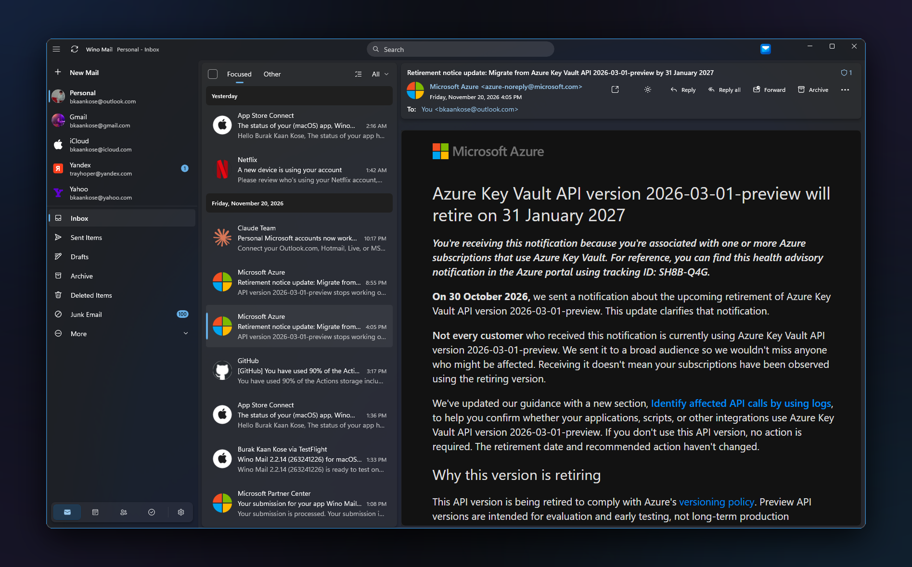

  

<h1 align="center">Wino Mail</h1>

  A native mail, calendar, contacts and To Do client for Windows, macOS and Linux.

  <a href="https://apps.microsoft.com/detail/Wino%20Mail/9NCRCVJC50WL?launch=true&mode=full">Microsoft Store</a>
  · <a href="https://www.winomail.app/download">All downloads</a>
  · <a href="https://github.com/bkaankose/Wino-Mail/releases">Release notes</a>
  · <a href="CONTRIBUTING.md">Contributing</a>

  

## Motivation

I'm a big fan of Windows Mail & Calendars due to its simplicity. Personally, I find it more intuitive for daily use cases compared to Outlook desktop and the new WebView2 powered Outlook version. Seeing [Microsoft deprecating it](https://support.microsoft.com/en-us/office/outlook-for-windows-the-future-of-mail-calendar-and-people-on-windows-11-715fc27c-e0f4-4652-9174-47faa751b199#:~:text=The%20Mail%20and%20Calendar%20applications,will%20no%20longer%20be%20supported.) dragged me into starting to work on Wino a couple of years ago. Wino's main motivation is to bring all the existing functionality from Mail & Calendars over time without changing the user experience that millions have loved since the Windows 8 days in Mail & Calendars.

Wino has since grown beyond Windows. Every app shares one .NET backend, its ViewModels and its translations, and adds a native interface for its platform.

## Download

| Platform | Status | Get it |
| --- | --- | --- |
| **Windows 10 and 11** | Stable | [Microsoft Store](https://apps.microsoft.com/detail/Wino%20Mail/9NCRCVJC50WL?launch=true&mode=full) · [App Installer](https://download.winomail.app/WinoMail.appinstaller) · [Beta](https://download.winomail.app/WinoMailBetaIsolated.appinstaller) |
| **macOS** (Apple silicon and Intel) | Beta | [Signed DMG](https://www.winomail.app/download) with automatic updates; Mac App Store coming soon |
| **Linux** (amd64) | Beta | [`.deb`](https://download.winomail.app/linux/beta/wino-mail_amd64.deb) for Ubuntu and Debian · [`.pkg.tar.zst`](https://download.winomail.app/linux/beta/wino-mail-x86_64.pkg.tar.zst) for Arch and Omarchy · [`.rpm`](https://download.winomail.app/linux/beta/wino-mail.x86_64.rpm) for Fedora |
| **iPhone and iPad** | In development | |
| **Android** | In development | |

The Windows beta installs next to the Store version and gets changes before they reach the Store. The macOS and Linux betas check for updates in the app. [GitHub Releases](https://github.com/bkaankose/Wino-Mail/releases) lists every stable Windows version with its full list of changes.

## Features

### Accounts and providers

- **Outlook and Microsoft 365**, **Gmail** and **Google Workspace**, **iCloud**, **Yahoo**, **Yandex** and any **IMAP** or **POP3** server
- **On-premises Exchange Server** for mail, calendar, contacts and To Do
- **CalDAV and CardDAV** for calendars, contacts and tasks, set up together with the mail account
- Secure browser sign-in (OAuth) for IMAP providers that support it
- **Account groups**: gather accounts under a named group with its own color and icon, with one combined inbox or separate folders
- Aliases, self-signed and private-server certificates you choose to trust, and backup and restore of your settings

### Mail

- Focused and Other inbox, conversation threading, and grouping by day or by date ranges
- Rich HTML composer with signatures, templates, and undo send
- Search across accounts, folder pinning and renaming, categories, and mail filters
- Configurable hover and swipe actions per account, a reorderable reader toolbar, and new context menus
- Dark mode for messages, links opened in the browser or profile you choose, and EML file support
- Calendar invitations answered from a compact card, also for IMAP and POP3 accounts

### Calendar, contacts and To Do

- Day, week and month views with continuous scrolling and a current-time line
- Create and edit events, attendees, reminders, time zones and recurrence; ICS and `webcal` subscriptions
- Contacts with address books, contact lists and categories
- To Do lists from Microsoft To Do, Google Tasks, Exchange and CalDAV

### Wino Intelligence (opt-in)

- **Wino Assistant**: press a shortcut in any app, then type or say what to do with your mail, even several steps in one sentence
- **Smart labels** and a **daily briefing** that sort and summarize what arrived
- Summarize, translate and rewrite messages with AI

### Privacy and security

- Load everything, block trackers or block all remote content, with allow and block lists for senders and domains
- Tracking removed from links, and a warning before risky attachments open
- **App lock** with Windows Hello or a PIN of its own
- S/MIME signing and encryption
- Credentials stored in the operating system's secure store: Windows DPAPI, the Apple Keychain, and the Secret Service on Linux

### Notifications and integration

- Background synchronization and native notifications, with optional realtime push for new mail
- Windows 11 widgets, Windows 10 Live Tiles, a tray companion and unread badges
- `mailto`, `webcal` and `webcals` handling, keyboard shortcuts, and app modes you can hide when you don't use them

### Personalization

- Light, dark and Windows contrast themes, a theme gallery and custom themes
- Native interfaces on every platform: WinUI 3 on Windows, AppKit on macOS, GTK 4 and libadwaita on Linux
- Available in 28 languages

Feature availability differs between platforms while the macOS and Linux apps are in beta; Windows has the complete set.

## Platforms

| Platform | Application | Developer guide |
| --- | --- | --- |
| Windows | WinUI 3, MSIX, Native AOT | [Windows development](docs/harness/development-windows.md) |
| macOS | AppKit, Native AOT | [macOS development](docs/harness/development-macos.md) |
| Linux | GTK 4, libadwaita, WebKitGTK, Native AOT | [Linux development](docs/harness/development-linux.md) |
| iOS and iPadOS | UIKit, Mono AOT | [iOS development](docs/harness/development-ios.md) |
| Android | Android Views and Material Components, Mono AOT | [Android development](docs/harness/development-android.md) |

## Contributing

Read the [contribution guide](CONTRIBUTING.md) for developer setup, build commands, and contribution rules. Discuss large features in an issue or proposal first.

Wino started before the current AI era. The project welcomes AI-assisted contributions when they comply with its coding rules, architecture, and maintainer decisions; [AGENTS.md](AGENTS.md) is the guide for coding agents. Contributors remain responsible for every submitted change, including AI-assisted changes.

## Donate

Donations help to fund the project website and development costs.

- [Donate with PayPal](https://www.paypal.com/donate/?hosted_button_id=LGPERGGXFMQ7U)
- Buy the Unlimited Accounts add-on in Wino. It is a one-time purchase.

## License

See [`LICENSE.md`](LICENSE.md).
